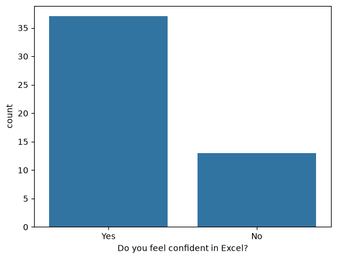
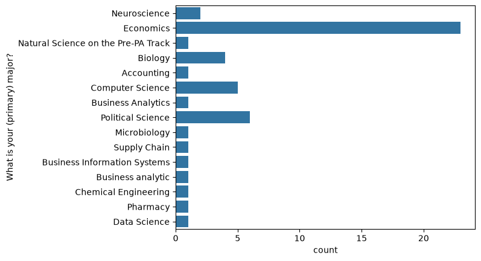

## ECON 0150 | Homework 1.1 {++Solutions++}

> *Due: Friday, Sept. 4 at 5PM*

Homework is designed to both test your knowledge and challenge you to apply familiar concepts in new applications. Answer clearly and completely. You are welcomed and encouraged to work in groups so long as your work is your own. Submit your figures and answers to Gradescope.

Lets use the class survey dataset to understand who is in our class!

### Q1. Data Selection

a) Who collected this data?

Taylor collected this data.

b) How was this data collected?

The data was collected in class using an online survey form.

c) What does this data miss?

It only covers students who were in class and chose to respond, so anyone absent or who skipped the survey is missing. It also covers only this section of the course, not all of ECON 0150 and certainly not all Pitt students, so it can't be used to describe a wider population. The answers are self-reported and approximate — distance from Pittsburgh is a guess, and a few responses are clearly mistyped — and the survey asks nothing about many things that might matter, such as prior coursework or how much programming students have done.

### Q2. Data Diagram

a) What is the index variable?

The index variable is the student, represented by the `Entry` column. Each row is one student's set of survey responses.

b) What is the data structure?

This is **cross-sectional** data. We observe many students at a single point in time.

c) How many (meaningful) variables does the dataset contain?

The dataset has 13 columns, but `Entry` is the index rather than a variable, which leaves **12 meaningful variables**.

It's reasonable to argue for fewer: `When is your birthyear?` and `When is your birthmonth?` are both derived from `When is your birthday?`, so they carry no information the dataset doesn't already have.

### Q3. What is each of the following variable’s type?

a) "What is your favorite color?"

- Binary Categorical
- Nominal Categorical
- Ordinal Categorical
- Discrete Numerical
- Continuous Numerical

**Nominal Categorical** — colors are categories with no natural ordering.

b) "Approximately how many miles away from Pittsburgh is your hometown?"

- Binary Categorical
- Nominal Categorical
- Ordinal Categorical
- Discrete Numerical
- Continuous Numerical

**Continuous Numerical** — distance can take any value in a range, including decimals.

c) "What is your (primary) major?"

- Binary Categorical
- Nominal Categorical
- Ordinal Categorical
- Discrete Numerical
- Continuous Numerical

**Nominal Categorical** — majors are categories with no natural ordering.

d) "How much did you like your statistics class?"

- Binary Categorical
- Nominal Categorical
- Ordinal Categorical
- Discrete Numerical
- Continuous Numerical

**Ordinal Categorical** — a 1-10 rating has a natural order, but the gaps between ratings aren't meaningful.

e) "How excited are you for this class?"

- Binary Categorical
- Nominal Categorical
- Ordinal Categorical
- Discrete Numerical
- Continuous Numerical

**Ordinal Categorical** — a 1-10 rating has a natural order, but the gaps between ratings aren't meaningful.

f) "Do you feel confident in Excel?"

- Binary Categorical
- Nominal Categorical
- Ordinal Categorical
- Discrete Numerical
- Continuous Numerical

**Binary Categorical** — only two possible responses, Yes or No.

### Q4. Summarize 'Do you feel confident in Excel?'.

a) Appropriately visualize the variable 'Do you feel confident in Excel?'.

b) How many students in the class feel confident in Excel?

**37 students** feel confident in Excel (13 do not).

### Q5. Summarize 'What is your major?'.

a) Appropriately visualize the variable 'What is your major?'.

b) How many students in the dataset are not economics majors?

23 of the 50 students are economics majors, so **27 students are not** economics majors.
