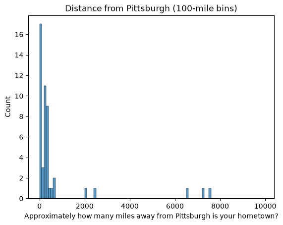
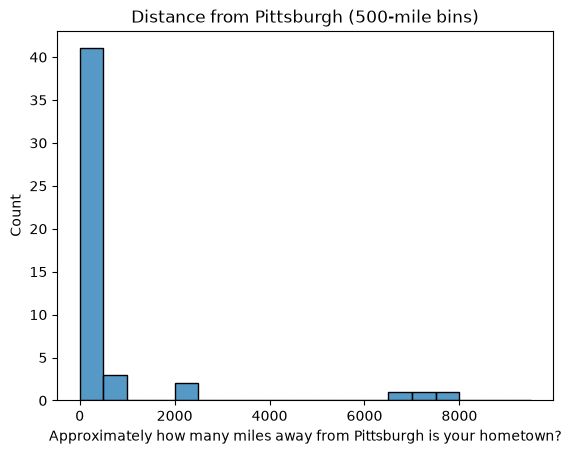
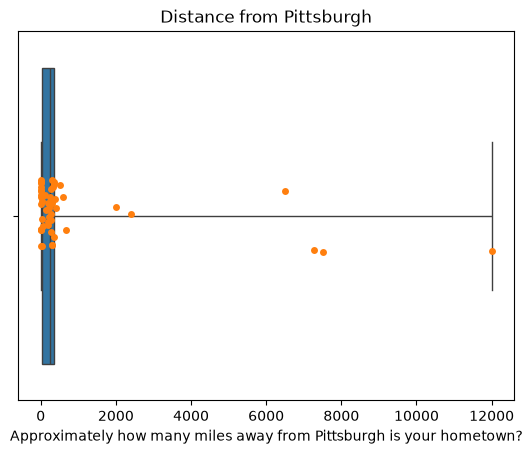
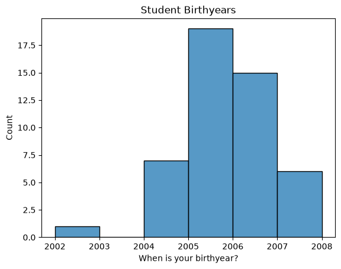
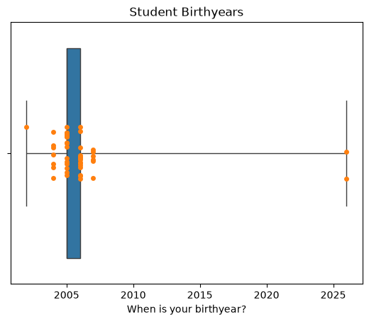
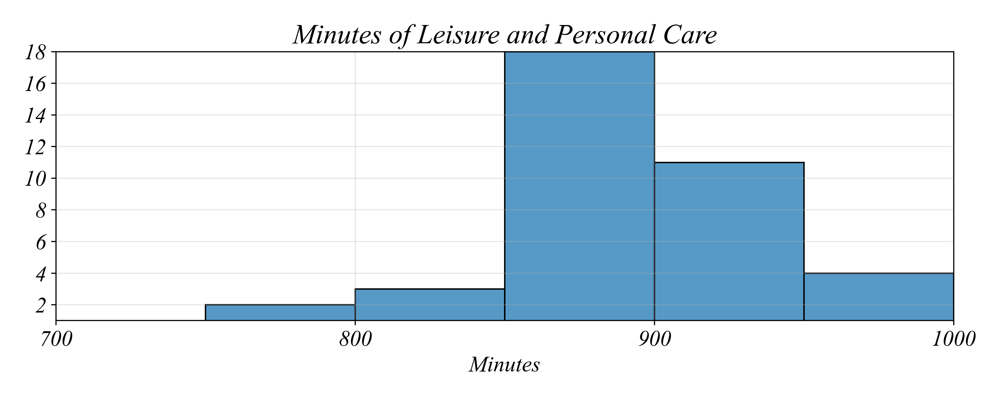

## ECON 0150 | Homework 1.2 {++Solutions++}

> *Due: Friday, Sept. 4 at 5PM*

Homework is designed to both test your knowledge and challenge you to apply familiar concepts in new applications. Answer clearly and completely. You are welcomed and encouraged to work in groups so long as your work is your own. Submit your figures and answers to Gradescope.

Lets continue using the class survey dataset to understand who is in our class!

### Q1. Histograms, Means, and Standard Deviations

Use the class survey dataset to create a histogram of "Approximately how many miles away from Pittsburgh is your hometown?"

a) Create a histogram with bins of width 100 miles.



b) Create a histogram with bins of width 500 miles.



c) Which bin width better shows the distribution? Explain your reasoning in one sentence.

There isn't a correct answer here. In my opinion, the 100-mile bins better show the distribution because they reveal that most students are very close to Pittsburgh — the middle half of the class is between about 21 and 350 miles away — while 500-mile bins group too many different distances together and hide that concentration. But some will prefer the simplicity of the larger bins.

d) Calculate the mean distance from Pittsburgh.

{++925 miles++}

e) Calculate the standard deviation of distance from Pittsburgh.

{++2327 miles++}

f) Write a one-sentence interpretation using both values. (Example format: "The average student is about X miles from Pittsburgh; distances typically vary by about Y miles from that average.")

The average student is about 925 miles from Pittsburgh; distances typically vary by about 2327 miles from that average.

The standard deviation being larger than the mean is a hint that the distribution is badly skewed — worth noticing before Q2.

### Q2. Boxplots and Quartiles

Use the class survey dataset to create a boxplot with stripplot of "Approximately how many miles away from Pittsburgh is your hometown?"

a) Create a boxplot with stripplot.



b) What is the median distance from Pittsburgh?

{++250 miles++}

c) Explain why the mean (from Q1) and the median differ. (Hint: Think about the shape of the distribution.)

The distribution is right-skewed. Most students are relatively close to Pittsburgh (the median is 250 miles), but a handful are very far away — five students are more than 2000 miles out, and one is 12000 miles away. Those few large values pull the mean up to 925 while the median, which depends only on the middle position, stays at 250. That gap between 925 and 250 is the skew.

### Q3. Choosing the Right Tool

Use the class survey dataset to visualize "When is your birthyear?"

a) Create a histogram of birthyear.



b) Create a boxplot with stripplot of birthyear.



c) Given the number of students in our class, which visualization better shows the distribution of birthyears? Explain your reasoning in one sentence.

Two things are going on here.

First, the data has a problem: two students entered a birthday in 2026, so the boxplot shows them as extreme outliers and the histogram — whose bins stop at 2008 — leaves them out entirely. Spotting that is itself a good reason to plot data before trusting a summary of it.

Second, for the real birthyears, which run 2002 to 2007, the answer depends on your preference. Birthyear is discrete and takes only six values, so the stripplot piles points on top of each other and is hard to read. The histogram shows the shape more clearly — most of the class was born in 2005 or 2006 — while the boxplot is what makes the two bad values obvious.

```typst
#pagebreak()
```

### Q4. Interpreting Histograms

The following data from the Better Life Index was collected from OECD countries using time-use surveys. This question is aimed at practicing the skill of analyzing continuous variables displayed visually.



a) What is the most common 50 minute range of time spent on leisure?

- 750 - 800
- 800 - 850
- 850 - 900
- 900 - 950
- 950 - 1000

**850 - 900** (this is the tallest bar in the histogram)

b) In how many countries do people spend between 800 and 850 minutes on leisure and personal care?

**{++3++} countries** (read the height of the 800-850 bar)

c) How many countries spend more than 900 minutes on leisure and personal care?

**{++15++} countries** (sum of the 900-950 bar and the 950-1000 bar)

d) What is the approximate difference in counts between the two most common ranges?

**Approximately {++7++} countries** (the difference between the tallest bar at 850-900 and the second tallest bar)
