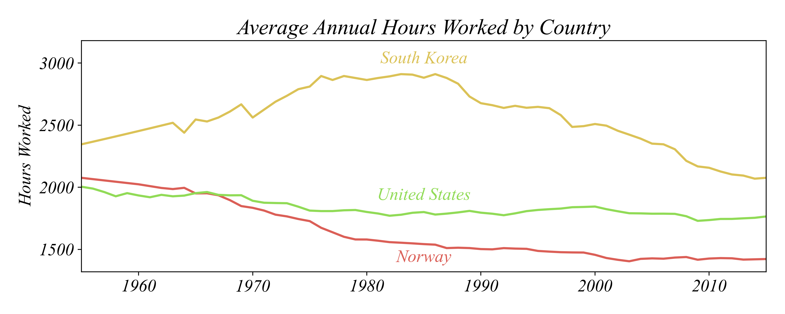
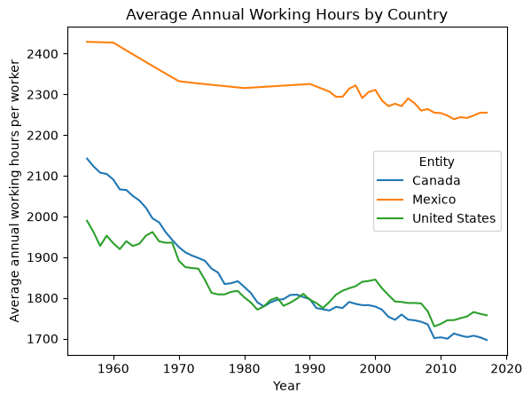
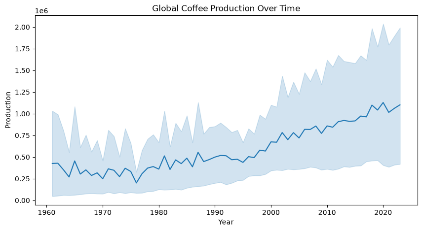
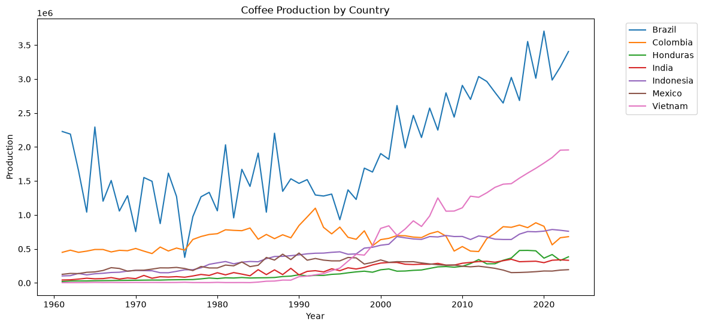
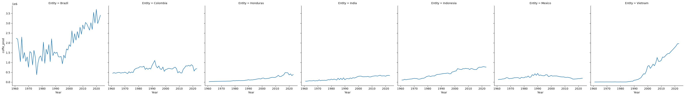
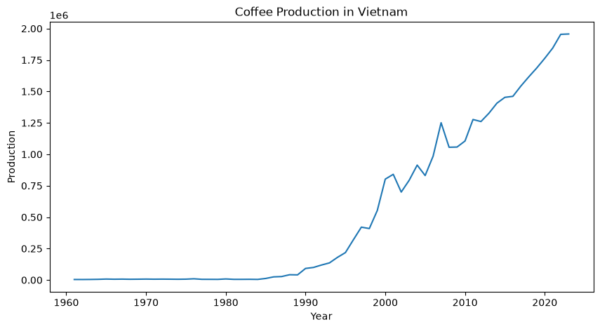

# ECON 0150 | Homework 1.4 {++Solutions++}

*Due: Sunday, Sept. 20*

Homework is designed to both test your knowledge and challenge you to apply familiar concepts in new applications. Answer clearly and completely. You are welcomed and encouraged to work in groups so long as your work is your own. Submit your figures and answers to Gradescope.

### Q1. Numerical Variables in Panel

The following data on hours worked is available from Our World in Data. This question is aimed at practicing the skill of making comparisons of numerical timeseries variables displayed visually.



a) In which country did people work the most on average?

- South Korea
- United States
- Norway

***South Korea***

b) When did Norwegians work less than Americans?

- Before 1963
- During 1963
- After 1963
- Never

***After 1963***

c) When was the largest difference between the longest and the shortest annual working time?

- 1960s
- 1980s
- 2000s
- 2010s

***1980s***

d) In the 1980s, roughly how many times more did an average South Korean work than an average Norwegian?

- 2x
- 3x
- 4x
- 5x

***2x***

e) Use `working_north_america.csv` to create a multiple line plot showing the average annual hours worked by country for the United States, Canada, and Mexico between 1956 and 2017.



```typst
#pagebreak()
```

### Q2. Multi-Country Coffee Production

Using the dataset `selected_coffee_prod_in_years.csv`, which provides information on coffee production in different countries between 1961 and 2023:

a) Plot a line graph of global coffee production over time (the total across all countries for each year). Describe the trend.



**Answer:** Global coffee production shows a general upward trend from 1961 to 2023, with some year-to-year variability. Production has roughly tripled over this period.

b) Plot a line graph of coffee production for each country over time. Include all countries in a single figure.



c) Create a faceted line plot showing coffee production over time, with each country in its own panel. (*Hint: use `sns.relplot()` with `col='Entity'` and `col_wrap=4` and `kind='line'`.*)



d) Compare your multi-line plot from (b) with your faceted plot from (c). Which visualization makes it easier to see individual country trends? Which makes it easier to compare countries to each other?

**Answer:** The faceted plot (c) makes it easier to see individual country trends because each country has its own panel with an appropriate y-axis scale. The multi-line plot (b) makes it easier to compare countries directly since they share the same axes, but smaller producers like Honduras and Ethiopia are hard to see due to Brazil's dominant scale.

e) Choose one of the top coffee-producing countries and plot its coffee production over time. Describe the pattern and propose possible explanations (e.g., conflict, policy changes, new entrants to the market).



**Answer:** Any of the top producers works here. Vietnam is a striking example: production was negligible through the 1960s and 1970s, stayed low through the war years and the planned economy, and then took off after the Đổi Mới market reforms of the late 1980s, growing from a minor producer to the second-largest in the world by the 2000s. Brazil shows a different pattern: it was already the dominant producer in 1961, and its series is dominated by large year-to-year swings (frosts and droughts, plus the biennial bearing cycle of coffee trees) on top of a gradual upward trend. Colombia is a third option: production rose through the 1970s and 1980s, fell in the 1990s and 2000s (coffee rust, low prices, aging trees), and has partly recovered since. Answers should describe the pattern in the figure and propose a plausible explanation.
