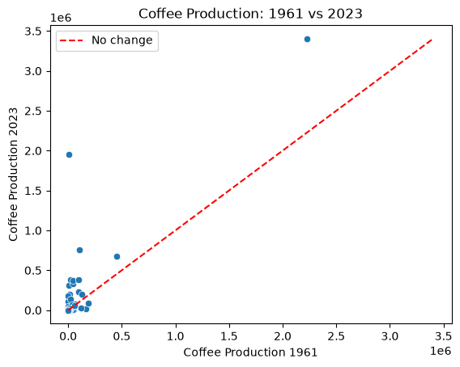

# ECON 0150 | Homework 1.5 (Optional Question) {++Solutions++}

*Due: Tuesday, Sept. 29*

Homework is designed to both test your knowledge and challenge you to apply familiar concepts in new applications. Answer clearly and completely. You are welcomed and encouraged to work in groups so long as your work is your own. Submit your figures and answers to Gradescope.

### Q1 (optional addition to Homework 1.5). Comparing Coffee Production Across Time

Using the dataset `coffee_prod_in_years.csv`, which provides information on coffee production in different countries between 1961 and 2023. This dataset is in **long format**. To create a scatter plot comparing two years, you'll first need to reshape it to wide format using `pivot()`.

a) Reshape the data to wide format, then generate a scatter plot comparing coffee production in 1961 and 2023 for each country. Include a 45-degree line to help identify which countries increased or decreased production. Are there outlier countries? Briefly suggest why these countries might stand out.

**Answer:** Brazil stands out as a clear outlier with by far the highest production in both years. Vietnam is another outlier — it had virtually no production in 1961 but became the second-largest producer by 2023 (due to government policies promoting coffee after the Doi Moi reforms). Most countries cluster near the origin with modest production levels.

b) How many countries increased their coffee production between 1961 and 2023? How many decreased? (*Hint: you can count points above vs below the 45-degree line, or create a column for the change and filter.*)

**Answer:** Read the counts from the output above. Most coffee-producing countries have increased production since 1961, though some traditional producers may have decreased. {++45 countries increased and 31 decreased.++}

c) In HW 1.4, you created a multi-line plot showing coffee production for each country over time. Which figure — the country-level time trends (from HW 1.4) or the 1961 vs. 2023 scatter comparison (from part a) — better helps you understand patterns in coffee production? Justify your answer.

**Answer:** The scatter plot makes it easier to see the overall pattern of change — most countries are above the line, meaning production increased. However, the multi-line plot reveals *when* changes occurred, showing if growth was steady or had sudden shifts (like Vietnam's explosive growth starting in the 1990s). The time trends provide richer context about the trajectory, while the scatter plot gives a cleaner summary of net change.
