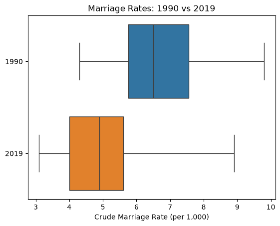
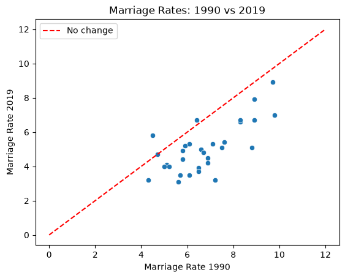

# ECON 0150 | Homework 1.5 {++Solutions++}

*Due: Tuesday, Sept. 29*

Homework is designed to both test your knowledge and challenge you to apply familiar concepts in new applications. Answer clearly and completely. You are welcomed and encouraged to work in groups so long as your work is your own. Submit your figures and answers to Gradescope.

### Q1. Transforming Marriage Rates

The following questions are based on **crude marriage rates** in `marriage_rates.csv` (numbers of marriages per one thousand inhabitants) in 1990 and 2019. Each row represents a different European country.

a) Create a multi-boxplot comparing the distribution of marriage rates in 1990 vs 2019. Based on the boxplots, did marriage rates generally increase or decrease across European countries? (*Hint: use `sns.boxplot(marriage[['1990', '2019']], whis=(0, 100))`.*)

**Answer:** Marriage rates generally decreased across European countries. The boxplot for 2019 is shifted to the left compared to 1990, showing a lower median and overall lower values.

b) Create a new column of absolute change in marriage rates from 1990 to 2019. Compute the **absolute change** in the marriage rate by subtracting the old value from the new value. Which country in this dataset has the largest absolute change between these years? (*Hint: do not take an absolute value; treat 1 as larger than −2.*)

**Answer:** The country with the largest absolute change is the one at the top of the sorted table (highest value, which could be positive or least negative). Countries like Iceland or Hungary may show increases, while most European countries show decreases. {++Iceland.++}

c) Create a new column of relative change in marriage rates from 1990 to 2019. Compute the **relative change** as the ratio resulting from dividing the absolute change by the old value. Which country in this dataset has the largest relative change between these years?

**Answer:** The country with the largest relative change is at the top of the sorted table. This measures proportional change relative to the starting value. {++Iceland.++}

d) Create a scatterplot comparing marriage rates in 1990 (x-axis) vs 2019 (y-axis). Add a 45-degree line to show where countries would fall if their marriage rate stayed the same. Which countries are above the line? What does being above the line mean?

**Answer:** Countries above the 45-degree line (like Iceland and Hungary) have higher marriage rates in 2019 than in 1990 — their marriage rates increased. Being above the line means the 2019 value is greater than the 1990 value.
