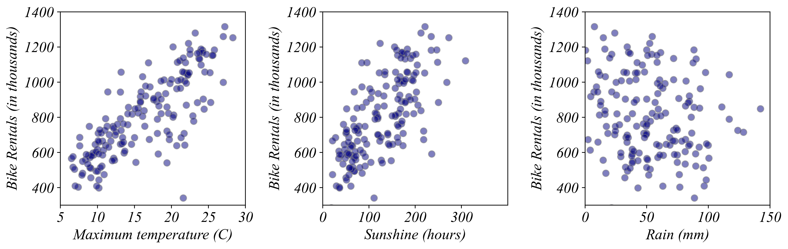
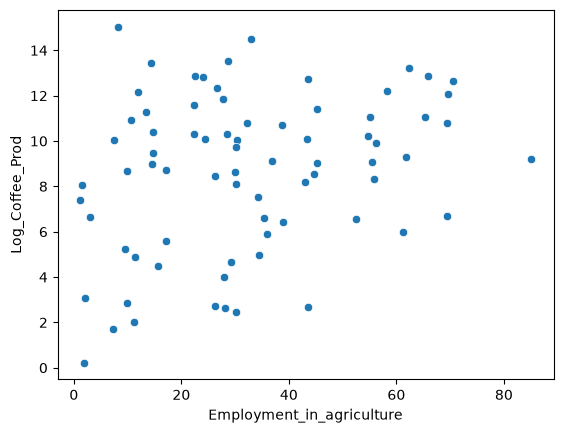

# ECON 0150 | Homework 2.1 {++Solutions++}

*Due: Friday, Oct. 2 at 5PM*

Homework is designed to both test your knowledge and challenge you to apply familiar concepts in new applications. Answer clearly and completely. You are welcomed and encouraged to work in groups so long as your work is your own. Submit your figures and answers to Gradescope.

### Q1. Bike Rentals and Weather

In the following questions, we'll analyze a data set that includes the monthly number of bike rentals in London as well as monthly weather data: minimum and maximum temperature in degrees Celsius, rain in millimeters, and hours of sunshine.

a) From the list below, how much did it rain in the month with the largest number of bike rentals?

- 7.6 mm
- 27.6 mm
- 137.6 mm
- 157.6 mm

**{++7.6 mm++}** ✓

The month with the largest number of bike rentals (~{++1,300++} thousand) corresponds to roughly {++8++} mm of rain in the rightmost scatterplot.

b) When were bikes most popular?

- In very sunny months
- In moderately sunny months
- In cloudy months
- Sunshine and bike rentals were not strongly related

**In very sunny months** ✓

The middle scatterplot shows a clear positive relationship between sunshine hours and bike rentals — the most popular months for biking had the most sunshine.

c) In months with what maximum temperatures were bikes most popular?

- Between 5 C and 10 C
- Between 15 C and 20 C
- Between 25 C and 30 C
- Maximum temperature and bike rentals were not strongly related

**Between 25 C and 30 C** ✓

The left scatterplot shows a strong positive relationship between maximum temperature and bike rentals, with the highest rental counts occurring at temperatures around 25–30°C.

### Q2. Coffee Production and Agricultural Employment

The dataset `coffee_prod_agr.csv` provides information on coffee production and employment in agriculture across different countries in 2023, merged from data available at [Our World In Data](https://ourworldindata.org/grapher/coffee-production-by-region?tab=table) and [The World Bank](https://data.worldbank.org/indicator/SL.AGR.EMPL.ZS).

a) Briefly describe the organizations that collected the data reported in each source using the links provided.

The coffee production data comes from Our World in Data, which compiles data from the International Coffee Organization (ICO) and the Food and Agriculture Organization (FAO) of the United Nations. The employment in agriculture data comes from The World Bank, which draws on estimates from the International Labour Organization (ILO).

b) Identify one potential limitation in the data.

One potential limitation is that the data merges cross-sectional observations from different countries, so differences in measurement methods, reporting standards, or time periods across countries could introduce inconsistencies. Additionally, the employment data captures all agricultural employment, not just coffee-related employment, which limits how directly we can interpret the relationship.

c) Create a log transformation of the `Coffee_Prod` as the new variable `Log_Coffee_Prod`. Then visualize the relationship between `Employment_in_agriculture` and `Log_Coffee_Prod`.

d) Describe the relationship: positive, negative, unclear.

The relationship between employment in agriculture and log coffee production appears **positive** — countries with a higher share of employment in agriculture tend to produce more coffee.

e) Why might we see this relationship between log coffee production and employment in agriculture?

Countries with large agricultural sectors tend to be developing economies with climates suitable for coffee cultivation. Coffee is a labor-intensive crop, so countries that produce more coffee naturally have more workers in agriculture. There may also be a confounding factor: countries near the equator tend to have both favorable coffee-growing conditions and economies more reliant on agriculture.
