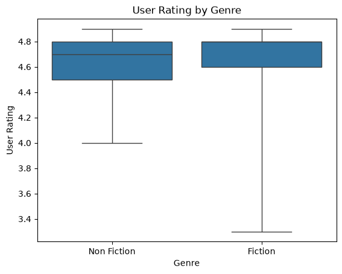
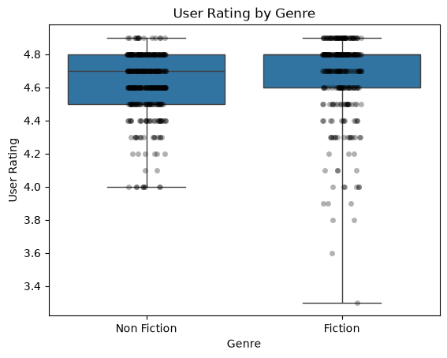
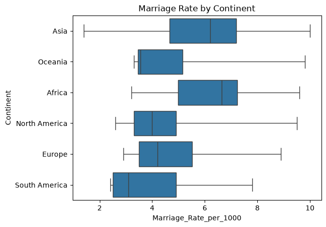
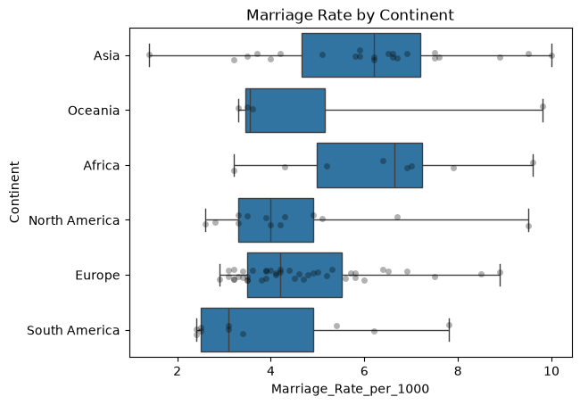

# ECON 0150 | Homework 2.2 {++Solutions++}

*Due: Friday, Oct. 9 at 5PM*

Homework is designed to both test your knowledge and challenge you to apply familiar concepts in new applications. Answer clearly and completely. You are welcomed and encouraged to work in groups so long as your work is your own. Submit your figures and answers to Gradescope.

### Q1. Amazon Book Sales by Genre

The dataset `amazon_book_sales.csv` lists Amazon's 50 bestselling books each year from 2009 to 2022. The column `Genre` marks each as Fiction or Non Fiction.

a) Create a boxplot showing the distribution of `User Rating` by `Genre`.

b) Add a stripplot on top of your boxplot to see individual books.

c) Calculate the mean, standard deviation, and count of `User Rating` by `Genre`.

{++Fiction: mean 4.66, standard deviation 0.25, count 312. Non Fiction: mean 4.62, standard deviation 0.19, count 388.++}

d) Which genre has the higher average rating? Do the two distributions overlap much?

Fiction has a slightly higher average rating. Yes, there is substantial overlap between the two distributions — the boxplots show that most of the interquartile ranges overlap, and the stripplot reveals many individual books from both genres at similar rating levels.

### Q2. Marriage Rates by Continent

The dataset `marriage_rates_by_continent.csv` reports the **crude marriage rate**, marriages per one thousand inhabitants, for one country per row.

a) Create a boxplot of `Marriage_Rate_per_1000` by `Continent`.

b) Add a stripplot to see individual countries within each continent.

c) Calculate the mean, standard deviation, and count by continent.

{++Mean, standard deviation, count. Africa: 6.31, 2.04, 8. Asia: 6.06, 2.07, 23. Europe: 4.67, 1.47, 42. North America: 4.47, 1.86, 13. Oceania: 5.05, 3.17, 4. South America: 3.88, 1.91, 10.++}

d) Which continent has the lowest mean marriage rate? Which has the highest standard deviation?

South America has the lowest mean marriage rate (3.88 per 1,000). Oceania has the most variation (std = 3.17), though it only has 4 countries in the sample. Among continents with larger samples, Asia has the most variation (std = 2.07).
