---
format:
  revealjs:
    css: custom.css
    transition: none
    aspect-ratio: "16:9"
---

## ECON 0150 | Economic Data Analysis {.center}

The economist's data analysis skillset.

 

### *Part 2 | Wrap Up*

---

## The Part 2 Toolkit

Three figures, each matched to a set of variables

 

| Part | Variables | Figure | Later becomes... |
|------|-----------|--------|------------------|
| 2.1 | Numerical by Numerical | Scatterplot | Regression (Part 4) |
| 2.2 | Numerical by Categorical | Boxplot (+ stripplot) | Two-sample test (Part 3) |
| 2.3 | Numerical by Numerical by Categorical | Scatter colored by category | Regression with a control (Part 5) |

. . .

 

Before we draw, we prepare: **filter** rows that don't belong, **log** skewed variables, **merge** data from different sources.

# Choose the Visualization

---

## Exercise 1: Commuting and Gas

What are the variable types, and what figure would you draw?

A dataset on commute distance and monthly gas spending for 30 workers.

| Commute_Miles | Gas_Spend |
|---------------|-----------|
| 2.2 | 53 |
| 37.4 | 211 |
| 31.8 | 180 |
| 14.7 | 99 |
| 28.1 | 156 |

. . .

**Variable Types:** Numerical by Numerical

---

## Exercise 1: Commuting and Gas

What are the variable types, and what figure would you draw?

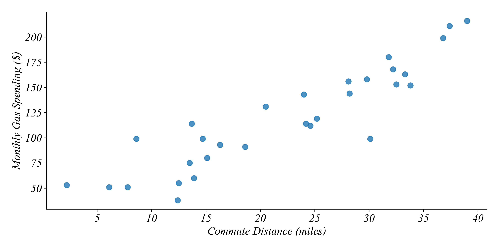

A ***Scatterplot*** shows how one numerical variable moves with another.

---

## Exercise 2: Rent by Area

What are the variable types, and what figure would you draw?

A dataset on monthly rent for 75 apartments.

| Area | Rent |
|------|------|
| Urban | 2130 |
| Rural | 1060 |
| Urban | 1720 |
| Rural | 860 |
| Rural | 950 |

. . .

**Variable Types:** Numerical by Categorical

---

## Exercise 2: Rent by Area

What are the variable types, and what figure would you draw?

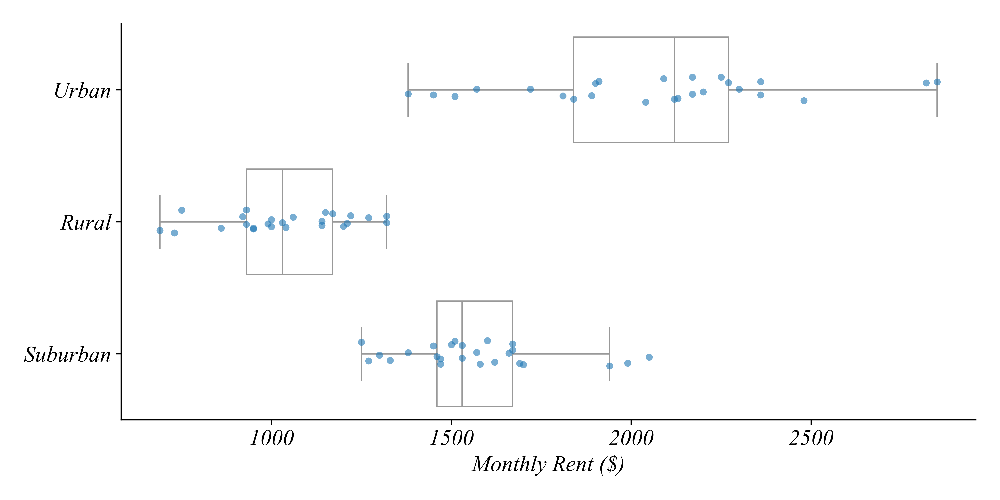

A ***Boxplot by category*** compares the distribution across groups. The ***stripplot*** shows each apartment.

---

## Exercise 3: Studying and Exam Scores

What are the variable types, and what figure would you draw?

A dataset on weekly study hours and exam scores for students in two course formats.

| Format | Study_Hours | Exam_Score |
|--------|-------------|------------|
| Online | 3.5 | 65 |
| Online | 13.4 | 83 |
| Online | 0.8 | 51 |
| In-Person | 0.9 | 65 |
| In-Person | 1.3 | 70 |

. . .

**Variable Types:** Numerical by Numerical by Categorical

---

## Exercise 3: Studying and Exam Scores

What are the variable types, and what figure would you draw?

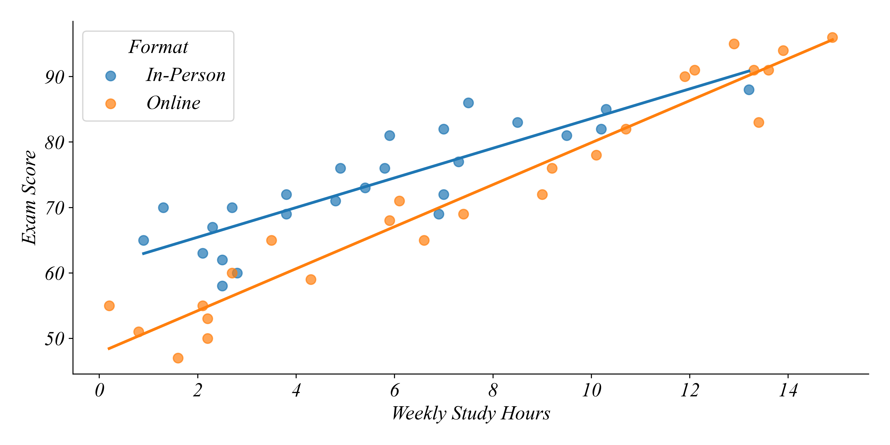

A ***Scatter colored by category*** shows whether the *relationship* differs between groups.

---

## Exercise 4: Inflation and Unemployment

What are the variable types, and what figure would you draw?

US unemployment and inflation rates each year since 2015.

| year | unemployment | inflation |
|------|--------------|-----------|
| 2015 | 5.3 | 0.1 |
| 2016 | 4.9 | 1.3 |
| 2017 | 4.4 | 2.1 |
| 2018 | 3.9 | 2.4 |
| 2019 | 3.7 | 1.8 |

. . .

**Variable Types:** Numerical by Numerical, measured over time

---

## Exercise 4: Inflation and Unemployment

What are the variable types, and what figure would you draw?

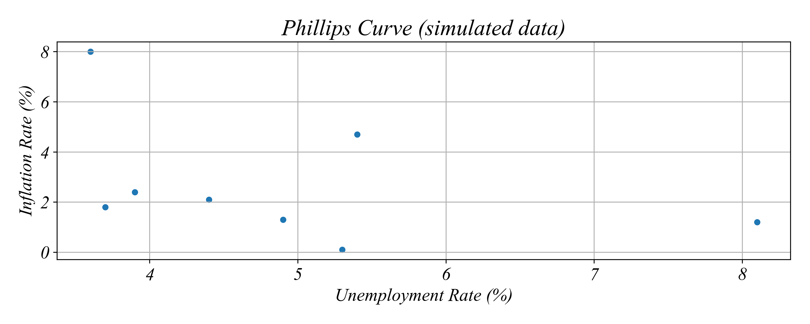

A ***Scatterplot*** works for timeseries too, like coffee and oil prices in Part 2.1. Labeling the points with years keeps the time order.

# Fix the Figure

---

## Fix the Figure

Each figure hides the pattern. What's the problem, and what's the fix?

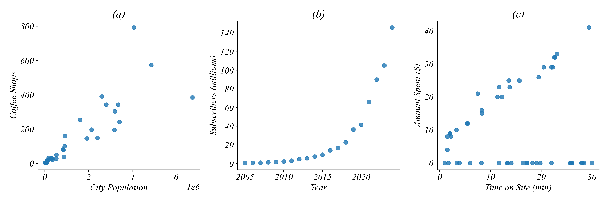

. . .

- **(a)** Both variables are skewed: most cities are crammed into the corner.
- **(b)** Subscribers grow by a constant *percentage* each year: the early years look flat.
- **(c)** Most visitors buy nothing: a row of zeros sits under the real relationship.

---

## Fix the Figure

Log both axes, log one axis, or filter

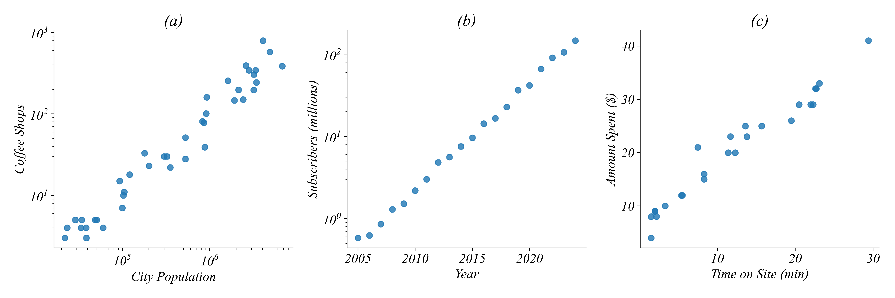

- **(a)** Log **both** axes: now each step is a multiple of the last.
- **(b)** Log the **y-axis only**: steady percentage growth becomes a straight line.
- **(c)** **Filter** to buyers: a log can't help here, since log(0) doesn't exist.

# Log Scales

---

## Reading Log Scales

Equal distances on a log scale mean equal multiples

a) On a log10 scale, each one-unit increase means the original value has been...

. . .

*multiplied by 10*

. . .

b) On a log2 scale, moving up 3 units means the original value has been multiplied by...

. . .

*2 × 2 × 2 = 8*

. . .

c) City A has log10(Population) = 4. City B has log10(Population) = 6. How many times larger is City B?

. . .

*Two units apart on log10: 10 × 10 = 100 times larger*

---

## Reading Log Scales

On the income axis in Part 2.3, what does equal spacing mean?

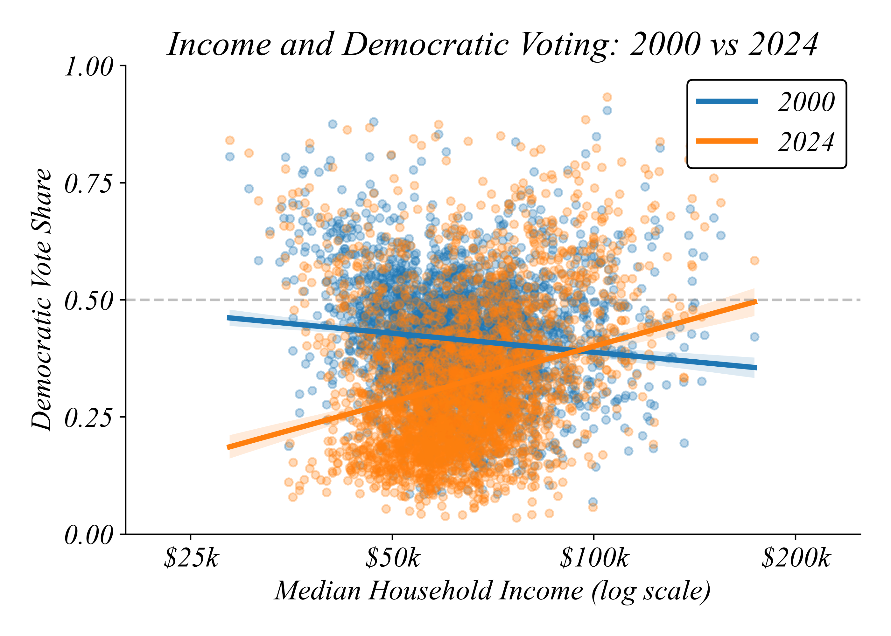{height=480}

. . .

*\$25k → \$50k → \$100k → \$200k: each step to the right is a **doubling** of income.*

---

## Reading Log Scales

Why not just log every skewed variable?

 

In Part 2.2, most Starbucks rows had zero revenue.

. . .

 

- log(0) is undefined, so logging a column of zeros fails.
- The zeros were a different kind of row: offers *viewed*, not purchases.
- **Filter first, then transform.**

# Investigate Before You Visualize

---

## Investigate: App Sessions

A coffee app records every session, whether or not the customer buys.

:::: {.columns}
::: {.column width="45%" .small}
| Session | Event | Minutes | Amount |
|---------|-------|---------|--------|
| S01 | Purchased | 4 | 6 |
| S02 | Browsed | 2 | 0 |
| S03 | Purchased | 9 | 11 |
| S04 | Browsed | 7 | 0 |
| S05 | Purchased | 15 | 17 |
| S06 | Browsed | 12 | 0 |
| S07 | Purchased | 6 | 8 |
| S08 | Browsed | 3 | 0 |
| S09 | Purchased | 12 | 14 |
| S10 | Browsed | 10 | 0 |
| S11 | Purchased | 18 | 21 |
| S12 | Browsed | 5 | 0 |
:::
::: {.column width="55%"}
a) Sketch a scatter of Minutes vs Amount using **all** the data.

b) Which rows should we drop to ask *"do longer sessions lead to bigger orders?"*

c) Sketch the scatter again after filtering.
:::
::::

---

## Investigate: App Sessions

All sessions vs. purchases only

:::: {.columns}
::: {.column width="50%"}
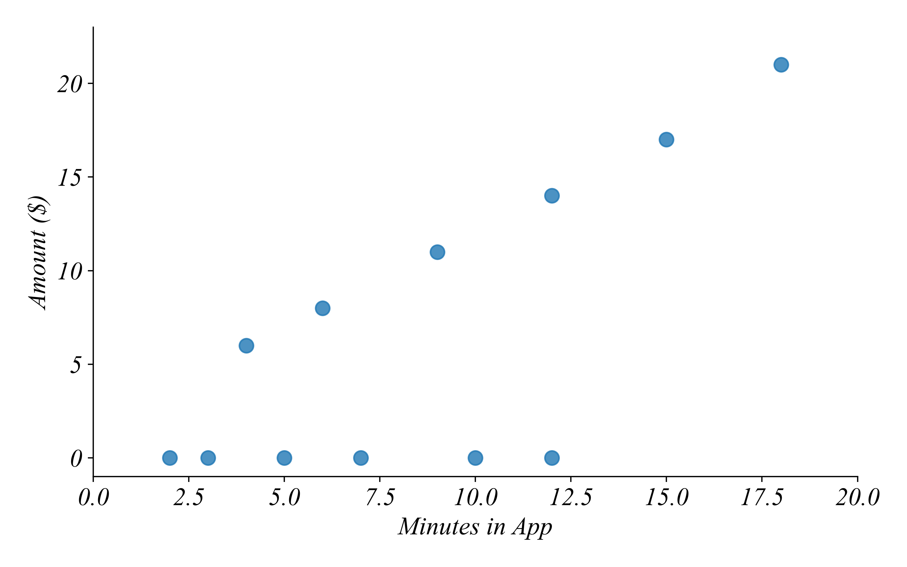

*All rows: half the points sit at zero and hide the pattern.*
:::
::: {.column width="50%"}
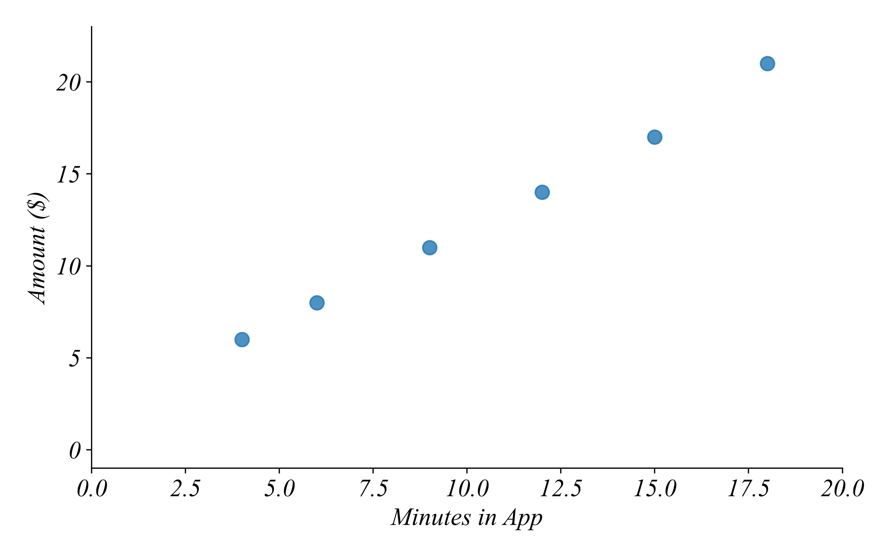

*Filter `Event == 'Purchased'`: longer sessions, bigger orders.*
:::
::::

# Filter, Group, Summarize

---

## Practice 1: Trace the Filter

Which apartments remain after filtering?

| Apt | Area | Rent | Bedrooms |
|-----|------|------|----------|
| A1 | Urban | 1850 | 1 |
| A2 | Rural | 900 | 3 |
| A3 | Suburban | 1400 | 2 |
| A4 | Urban | 1450 | 1 |
| A5 | Suburban | 1650 | 3 |
| A6 | Rural | 1200 | 2 |

**Filter:** `((Area == 'Urban') OR (Area == 'Suburban')) AND (Rent < 1500)`

. . .

*Answer: A3, A4*

---

## Practice 2: Build the Filter

Construct the boolean logic from the pieces

**Goal:** Find all apartments that are Rural, OR that have at least 2 bedrooms AND rent under \$1,500.

1. (Area == 'Rural')
2. (Bedrooms >= 2)
3. (Rent < 1500)
4. (Area == 'Urban')

. . .

*Answer: 1 OR (2 AND 3)*

. . .

*Using the table from Practice 1: A2, A3, A6*

---

## Practice 3: Filter → Group → Summarize

The Part 2.2 pipeline, by hand

| Txn | Offer | Event | Amount |
|-----|-------|-------|--------|
| T01 | BOGO 5 | Purchase | 12 |
| T02 | BOGO 10 | Viewed | 0 |
| T03 | BOGO 5 | Purchase | 20 |
| T04 | Discount | Purchase | 8 |
| T05 | BOGO 10 | Purchase | 30 |
| T06 | BOGO 5 | Viewed | 0 |
| T07 | Discount | Purchase | 16 |
| T08 | BOGO 10 | Purchase | 18 |

**Operations:** 1) Filter for `Event == 'Purchase'` 2) Group by Offer 3) Calculate the mean and count of Amount

---

## Practice 3: Filter → Group → Summarize

The Part 2.2 pipeline, by hand

 

| Offer | Mean Amount | Count |
|-------|-------------|-------|
| BOGO 5 | 16 | 2 |
| BOGO 10 | 24 | 2 |
| Discount | 12 | 2 |

. . .

 

**What if we forgot the filter?** BOGO 5 becomes (12 + 20 + 0) / 3 = 10.67, and BOGO 10 becomes (0 + 30 + 18) / 3 = 16.

. . .

*The viewed rows aren't purchases. Leaving them in drags every mean toward zero.*

# Relationships by Category

---

## Read a Scatter by Category

Hourly wage and experience for union and non-union workers

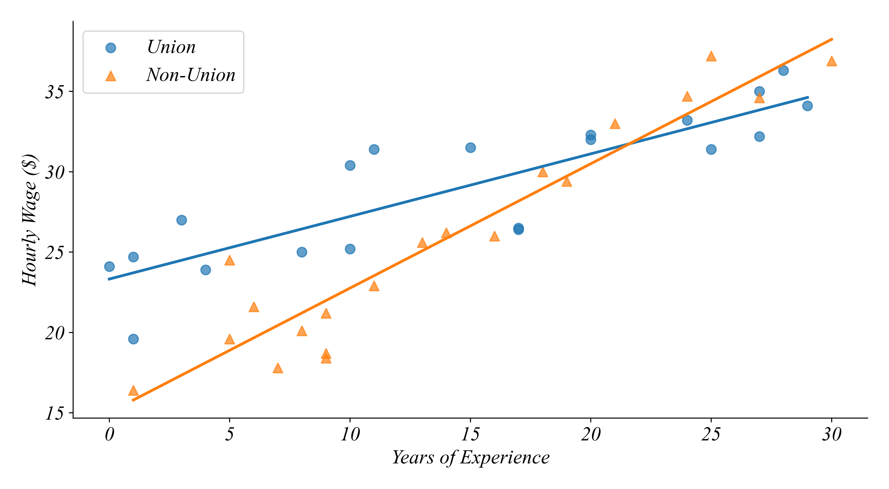{height=430}

a) As experience increases, wages for each group: increase, decrease, or no pattern?

b) At 5 years of experience, which group earns more? At 28 years?

c) How does the relationship differ between the two groups?

---

## Read a Scatter by Category

Hourly wage and experience for union and non-union workers

{height=430}

a) *Both increase.* b) *Union at 5 years; non-union at 28 years.*

c) *Union workers start higher, but non-union wages rise faster with experience (a steeper line).*

---

## Why Color by Category?

Each point is one day at one coffee shop

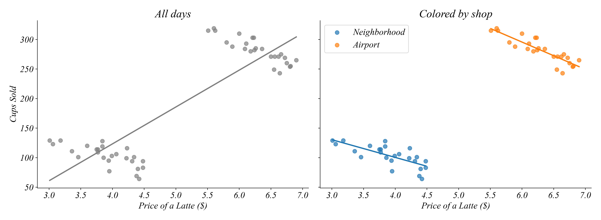

. . .

*All days together: higher prices, more cups sold. Is demand upward sloping?*

. . .

*Within each shop, higher prices sell **fewer** cups. The airport just has higher prices **and** more customers.*

---

## Why Color by Category?

The same lesson from Part 2.3

 

::: {.incremental}
- Counties shifted Republican on average (boxplot by year)
- Yet large, high-income counties vote Democratic (scatter)
- And the income relationship *flipped* between 2000 and 2024 (scatter by year)
- **A pattern in pooled data can differ from the pattern within each group.**
:::

# Combining and Reshaping Data

---

## Practice 4: Trace the Merge

`pd.merge(population, rents, on='City')`

:::: {.columns}
::: {.column width="45%"}
**population**

| City | Population |
|------|------------|
| Alder | 120,000 |
| Birch | 850,000 |
| Cedar | 2,400,000 |
| Dogwood | 45,000 |
:::
::: {.column width="55%"}
**rents**

| City | Rent_2019 | Rent_2024 |
|------|-----------|-----------|
| Alder | 950 | 1150 |
| Birch | 1300 | 1600 |
| Cedar | 2000 | 2300 |
| Elm | 800 | 980 |
:::
::::

. . .

How many rows in the merged data? Which cities drop out?

. . .

*3 rows. Dogwood and Elm drop out: each appears in only one table.*

---

## Practice 5: Trace the Melt

Wide to long, so year can become a category

:::: {.columns}
::: {.column width="45%"}
**Wide**

| City | Rent_2019 | Rent_2024 |
|------|-----------|-----------|
| Alder | 950 | 1150 |
| Birch | 1300 | 1600 |
| Cedar | 2000 | 2300 |
:::
::: {.column width="55%" .fragment}
**Long**

| City | Year | Rent |
|------|------|------|
| Alder | 2019 | 950 |
| Birch | 2019 | 1300 |
| Cedar | 2019 | 2000 |
| Alder | 2024 | 1150 |
| Birch | 2024 | 1600 |
| Cedar | 2024 | 2300 |
:::
::::

. . .

*3 rows become 6. Now `Year` is a column we can put on an axis or use for color.*

# Putting It Together

---

## A Research Question

Do bigger cities have higher rents, and has that changed since 2019?

 

Using the Part 2.3 template, which figure answers each question?

. . .

1. **Did rents rise?** Boxplot of Rent by Year
2. **Do bigger cities charge more?** Scatter of log Population vs Rent
3. **Has that relationship changed?** Scatter of log Population vs Rent, colored by Year

. . .

 

*Data steps: merge population and rents on City, melt the rent years, log population.*

---

## Part 2 | Summary

 

::: {.incremental}
- **Choose** the figure from the variable types: scatter, boxplot by category, or scatter by category
- **Filter** out rows that don't belong to the question before summarizing or plotting
- **Log** skewed variables: equal distances become equal multiples (but never log zeros)
- **Group** to summarize by category: one row per group
- **Merge** when the question needs variables from two sources; **melt** to turn columns into a category
:::
