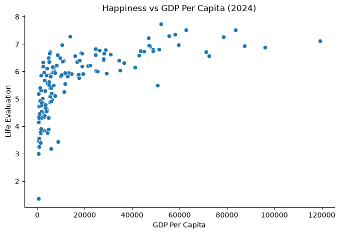
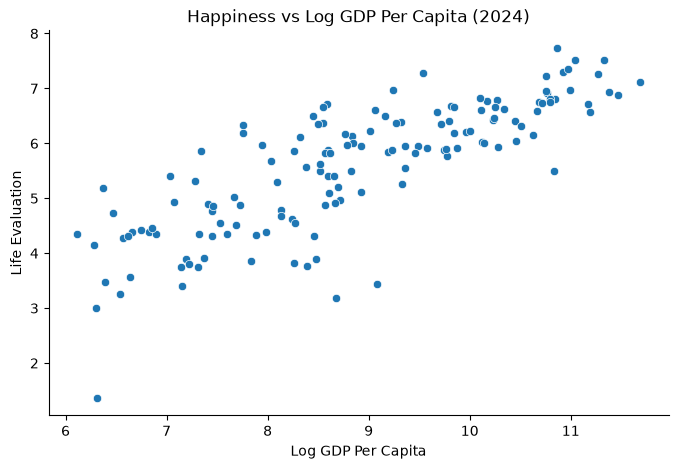
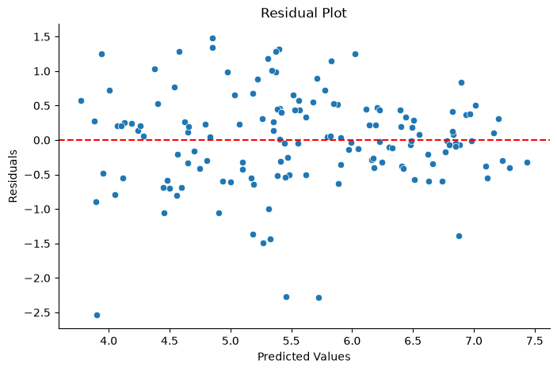
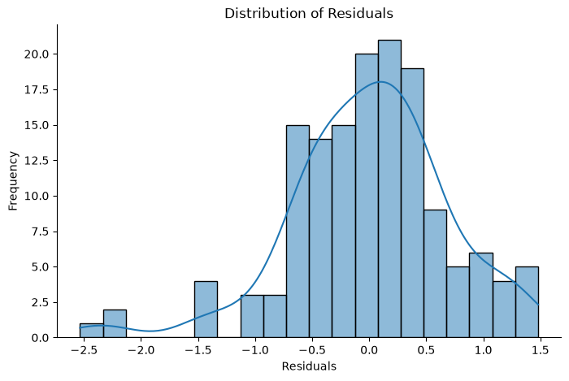
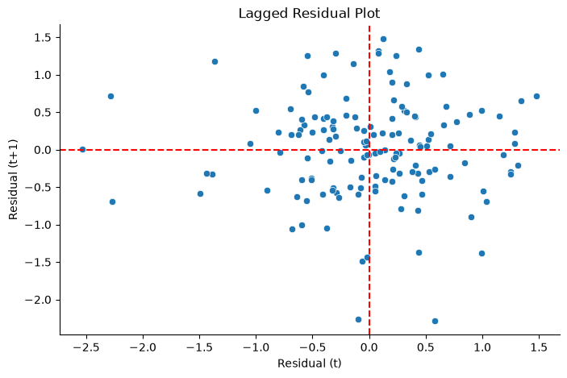

## ECON 0150 | Spring 2026 | Homework 4.3 {++Solutions++}

### Due: Sunday April 5, at 11:59 PM

Homework is designed to both test your knowledge and challenge you to apply familiar concepts in new applications. Answer clearly and completely. You are welcomed and encouraged to work in groups so long as your work is your own. Use the provided datasets to answer the following questions. Then submit your figures and answers to Gradescope.

#### Q1. Happiness and GDP

This question is based on our work during Exercise 4.1 and Exercise 4.3 in class. Use the happiness dataset `Life_Evaluation_GDP_PerCap.csv` to answer the following questions. The dataset contains the following variables:

- `Year`: year of observation
- `Country`: the country of observation
- `Life_Evaluation`: composite measure of happiness based on survey polling
- `GDP_Per_Cap`: the country's GDP in that year divided by the population

a) Create a scatterplot with GDP Per Capita on the horizontal axis and happiness on the vertical axis for the year 2024. 

b) Does there appear to be a relationship between the two variables? 

Yes. Countries with higher GDP Per Capita tend to have higher life evaluation scores, so there appears to be a positive relationship between the two variables.

c) Does the relationship appear to be linear?

No. The relationship appears to be curved -- happiness increases steeply at low levels of GDP Per Capita but levels off at higher levels. This suggests a logarithmic or concave relationship rather than a straight line.

d) Perform a log transformation of GDP Per Capita and create a scatterplot with log GDP Per Capita on the horizontal axis and happiness on the vertical axis. 

e) Fit a linear regression model to predict happiness using log GDP Per Capita. What is the interpretation of the intercept coefficient?

The intercept is the predicted life evaluation score when log GDP Per Capita equals zero, which corresponds to a GDP Per Capita of \$1. This is not a meaningful value in context, since no country has a GDP Per Capita that low. It serves as a mathematical anchor for the regression line.

f) What is the interpretation of the slope coefficient?

The slope coefficient tells us the predicted change in life evaluation for a one-unit increase in log GDP Per Capita. Because the independent variable is log-transformed, a one-unit increase in log GDP corresponds to multiplying GDP Per Capita by $e \approx 2.72$. So the slope represents the expected change in happiness when GDP Per Capita increases by a factor of $e$.

g) What is the interpretation of the p-value of the slope coefficient?

The p-value tests the null hypothesis that the slope coefficient equals zero (i.e., that there is no linear relationship between log GDP Per Capita and happiness). A very small p-value (well below 0.05) means we reject the null hypothesis and conclude that there is a statistically significant relationship between log GDP Per Capita and life evaluation.

#### Q2. Model Diagnostics

Using the model you fit in Q1(e), answer the following questions about model assumptions.

a) Extract the residuals and predicted (fitted) values from your model. Create a residual plot with predicted values on the x-axis and residuals on the y-axis. Add a horizontal line at zero.

b) Does the residual plot show signs of heteroskedasticity? Explain what you see and which assumption this relates to.

The residual plot shows some evidence of heteroskedasticity. The spread of the residuals is not perfectly constant across all levels of predicted values -- residuals appear slightly more spread out in some regions than others. This relates to the constant variance (homoskedasticity) assumption, which states that the variance of the error terms should be the same for all values of the independent variable.

c) Create a histogram of the residuals. Do they appear roughly normal?

The residuals appear roughly normally distributed. The histogram is approximately bell-shaped and centered near zero, with most values falling close to the center. This is consistent with the normality assumption.

d) Create a lagged residual plot by plotting each residual against the previous residual. Does this model appear to violate the independence assumption?

The lagged residual plot does not show a strong pattern. The points are scattered without a clear trend, which suggests that the independence assumption is not violated. Since these are cross-sectional data (different countries in the same year), we would not expect the residuals to be serially correlated.

e) Re-fit the model using robust standard errors by adding `cov_type='HC3'` to the `.fit()` call. How do the standard errors and p-values change compared to Q2(e)?

With robust standard errors (HC3), the coefficient estimates remain the same since robust standard errors do not change the point estimates. The standard errors may change slightly compared to the original model, reflecting the correction for potential heteroskedasticity. The p-values remain very small and statistically significant, but they may differ slightly from the original model. The key takeaway is that robust standard errors provide more reliable inference when heteroskedasticity is present.

#### Q3. Reading a Residual Plot

A researcher fits a linear model predicting test scores from hours of study. Their residual plot (predicted values on the x-axis, residuals on the y-axis) shows a clear fan shape: residuals are tightly clustered near zero for low predicted values but spread out widely for high predicted values.

a) Which model assumption does this residual plot suggest is violated?

The constant variance (homoskedasticity) assumption. This assumption states that the variance of the residuals should be the same across all levels of the predicted values. A fan shape indicates the variance is changing.

b) What is the name for this pattern?

This pattern is called heteroskedasticity (non-constant variance of the error terms).

c) Does this violation affect the estimated coefficients ($\hat\beta_0$ and $\hat\beta_1$), or does it affect the standard errors and p-values? Explain briefly.

Heteroskedasticity does not affect the estimated coefficients -- the OLS estimates of $\hat\beta_0$ and $\hat\beta_1$ remain unbiased. However, it does affect the standard errors and p-values. The usual standard errors are no longer reliable, which means the confidence intervals and hypothesis tests may be incorrect.

d) What is one approach the researcher could use to address this issue?

The researcher could use robust standard errors (e.g., HC3) when fitting the model. This corrects the standard errors to account for heteroskedasticity without changing the coefficient estimates, providing more reliable p-values and confidence intervals.
