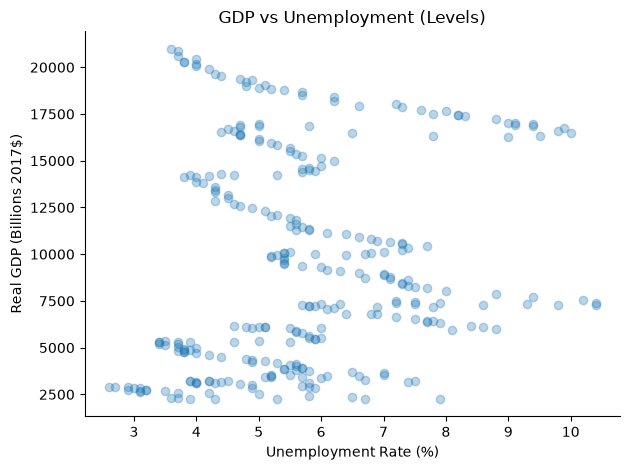
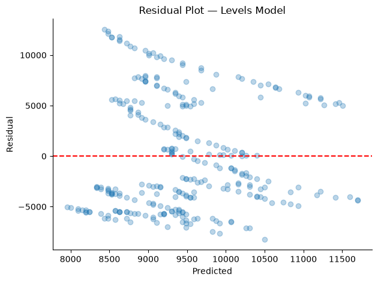
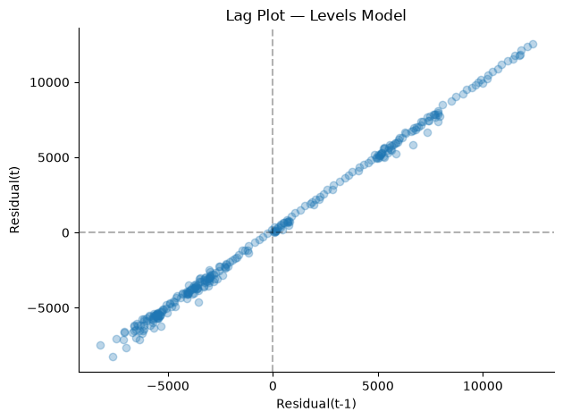
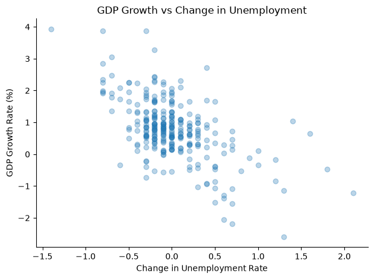
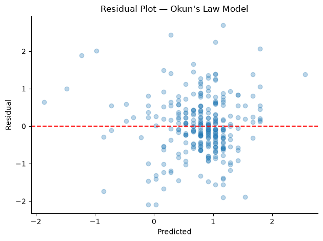
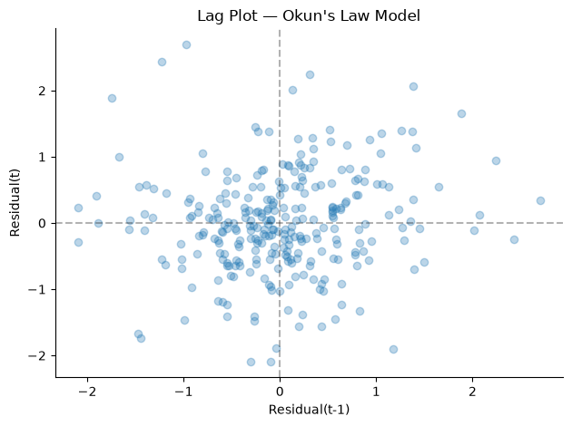

## ECON 0150 | Spring 2026 | Homework 4.4 {++Solutions++}

### Due: Sunday April 5, at 11:59PM

Homework is designed to both test your knowledge and challenge you to apply familiar concepts in new applications. Answer clearly and completely. You are welcomed and encouraged to work in groups so long as your work is your own. Use the provided datasets to answer the following questions. Then submit your figures and answers to Gradescope.

#### Q1. Okun's Law: Levels Model

Okun's Law is a well-known empirical relationship in macroeconomics: when unemployment rises, GDP tends to grow more slowly, and vice versa. In this question you will explore this relationship using quarterly US data from 1948–2019. The dataset `okun.csv` contains the following variables:

- `gdp`: real GDP (billions of 2017 dollars)
- `unemployment`: unemployment rate (%)
- `gdp_diff`: quarter-over-quarter change in GDP
- `unemployment_diff`: quarter-over-quarter change in unemployment rate
- `gdp_growth`: quarter-over-quarter GDP growth rate

a) Load `okun.csv` and create a scatterplot with `unemployment` on the x-axis and `gdp` on the y-axis.

b) Fit a linear regression model: `gdp ~ unemployment`. Report the estimated coefficients and p-values. Interpret $\hat\beta_1$: what does the sign suggest about the relationship between unemployment and GDP?

{++The estimated intercept is 6707.741 (p-value 0.000) and the estimated coefficient on `unemployment` is 479.649 (p-value 0.016).++}

**Interpretation:** The estimated coefficient on `unemployment` is positive, which suggests that higher unemployment is associated with higher GDP. This is counterintuitive and contradicts economic theory — Okun's Law predicts a negative relationship. The positive sign here is misleading and arises because both GDP and unemployment are trending over time. GDP has grown substantially over the sample period, and unemployment has fluctuated around a relatively stable mean but at higher GDP levels in later decades. The shared time dimension creates a spurious positive correlation.

c) Create a residual plot (predicted values on x-axis, residuals on y-axis). Does the model look well-specified?

**Interpretation:** The residual plot shows a clear non-random pattern — the residuals display a curved, structured shape rather than random scatter around zero. This indicates the model is not well-specified. The systematic pattern in the residuals suggests that a simple linear model of GDP on unemployment in levels does not adequately capture the relationship between these variables.

d) Create a lagged residual plot. Does the model show autocorrelation? What does this mean for the reliability of the regression results?

**Interpretation:** The lagged residual plot shows strong positive autocorrelation — the points cluster tightly along a line from the bottom-left (quadrant III) to the top-right (quadrant I). When the previous residual is positive, the current residual tends to be positive too, and vice versa. This means the residuals are not independent across time periods. Strong autocorrelation violates a key assumption of OLS regression, which means the standard errors are unreliable (typically too small), making hypothesis tests and confidence intervals invalid. We cannot trust the reported p-values.

#### Q2. Okun's Law: GDP Growth and Unemployment Changes

The levels model in Q1 regresses the *level* of GDP on the *level* of unemployment. But both variables trend over time: GDP grows while unemployment fluctuates around a stable mean. This shared time trend can create a spurious relationship.

Okun's Law is typically stated in terms of GDP *growth* and *changes* in unemployment: when unemployment rises, GDP growth slows.

a) Create a scatterplot with `unemployment_diff` on the x-axis and `gdp_growth` on the y-axis. How does this scatterplot compare to the one in Q1(a)?

**Interpretation:** This scatterplot looks very different from Q1(a). In Q1(a), the relationship appeared weakly positive and was driven by the time trend. Here, the relationship is clearly negative — when unemployment rises (positive change), GDP growth tends to be lower, and vice versa. The data points cluster around a downward-sloping pattern, which is consistent with Okun's Law. The scatter is also more evenly distributed rather than showing the structured, trend-driven pattern of the levels plot.

b) Fit the Okun's Law model: `gdp_growth ~ unemployment_diff`. Report the estimated coefficients and p-values. How does the sign of $\hat\beta_1$ compare to Q1(b)? Interpret $\hat\beta_1$ in context.

{++The estimated intercept is 0.788 (p-value 0.000) and the estimated coefficient on `unemployment_diff` is -1.261 (p-value 0.000).++}

**Interpretation:** The estimated coefficient on `unemployment_diff` is negative, which is the opposite sign from Q1(b). This is consistent with Okun's Law: a one percentage point increase in the unemployment rate is associated with a decrease in the GDP growth rate. The negative sign aligns with economic theory — when unemployment rises, the economy is producing less output relative to its potential, so GDP growth slows. The p-value is very small, indicating the relationship is statistically significant.

c) Create a residual plot for the Okun's Law model. Compare it to the residual plot from Q1(c). Which model appears better specified? Describe the differences you see.

**Interpretation:** The residual plot for the Okun's Law model looks much better than the one from Q1(c). The residuals appear to scatter more randomly around zero without the clear curved/structured pattern seen in the levels model. The Okun's Law model appears better specified because the residuals do not exhibit the systematic pattern that indicated misspecification in the levels model. While there may still be some heteroskedasticity or mild patterns, the improvement over Q1(c) is substantial.

d) Create a lagged residual plot for the Okun's Law model. Compare it to the lagged residual plot from Q1(d). Which model shows less autocorrelation? How can you tell from the plot?

**Interpretation:** The Okun's Law model shows much less autocorrelation than the levels model. In Q1(d), the lagged residual plot showed points clustered tightly along a diagonal line (strong positive autocorrelation concentrated in quadrants I and III). In the Okun's Law model, the points are spread more evenly across all four quadrants, indicating that knowing the previous residual gives much less information about the current residual. The cloud of points is more circular/random rather than elongated along the diagonal. This means the Okun's Law model better satisfies the independence assumption of OLS, making its standard errors and hypothesis tests more reliable.

e) Compare the levels model (Q1) and the Okun's Law model (Q2). The levels model shows a *positive* coefficient for unemployment on GDP, while the Okun's Law model shows a *negative* coefficient. Which result is more consistent with economic theory? Why does the levels model give a misleading result?

**Answer:** The Okun's Law model (Q2) gives the result that is consistent with economic theory. Economic theory predicts that when unemployment rises, output falls — this is the negative relationship captured by the Okun's Law model.

The levels model gives a misleading positive coefficient because both GDP and unemployment trend over time. GDP has grown steadily over the sample period (1948–2019), roughly {++growing ninefold++} in real terms. Meanwhile, unemployment fluctuates cyclically but is observed at all stages of this GDP growth. Because GDP is much higher in later decades regardless of the unemployment rate, the levels regression picks up a spurious positive correlation driven by the shared time dimension — not the true economic relationship between the two variables.

The Okun's Law specification solves this problem by removing the trend. Instead of using levels, it uses GDP growth rates (which remove the upward trend in GDP) and changes in unemployment (which remove any slow-moving trend in unemployment). By working with stationary, de-trended variables, the regression reveals the true negative relationship: when unemployment rises, GDP growth falls. This is a classic example of why regressing trending time series in levels can produce misleading (spurious) results, and why differencing or using growth rates is essential for proper inference.
